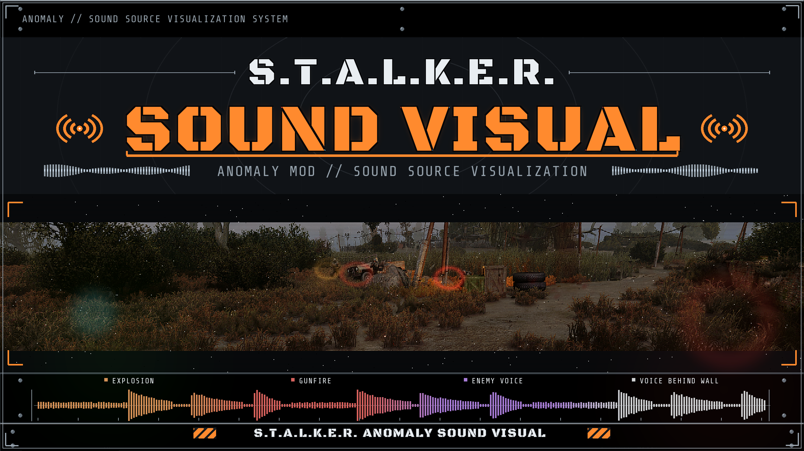
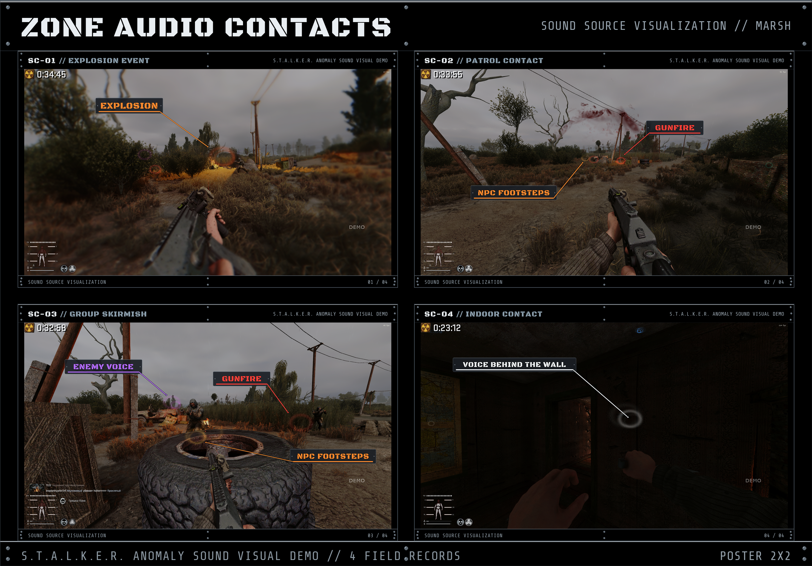

# Sound Vision  - Visual Sound Indicators

Sound Vision  - accessibility-мод для **S.T.A.L.K.E.R.: Anomaly** (1.5.1 / 1.5.2 / 1.5.3,
включая GAMMA и другие сборки). Создан для глухих и слабослышащих игроков: игра рисует
**расходящиеся кольца прямо на экране** в точке любого источника звука  - в том числе
**сквозь стены**. Что другие слышат, вы видите.

[English](README.md) | [Русский](README.ru.md)

*Медиа автора:* [Телеграм](https://t.me/ssurikinn) · [Твич](https://twitch.tv/ssurikin) · [Поддержать автора](https://donationalerts.com/r/ssurikinn)

# Скачать
[Репозиторий гитхаб](https://github.com/ssurikin/Stalker-Anomaly-Sound-Vision-mod/archive/refs/heads/main.zip)
[Страница на Moddb](https://www.moddb.com/mods/stalker-anomaly/addons/sound-vision-hearing-accessibility-mod)

---

## Что вы увидите

| Событие | Визуал |
|---|---|
| Кто-то идёт/бежит (в т.ч. за стеной) | жёлтые кольца в точке шагов  - только вблизи |
| Кто-то говорит, кричит, стонет | белые кольца |
| Выстрелы, перезарядка, попадания | красные кольца  - видны издалека, как и слышны |
| Взрывы гранат, подствольных и бочек | крупные оранжево-красные кольца |
| Мутанты (шаги, рычание, атаки) | фиолетовые кольца |
| Аномалии: гул в простое, шипение активации | бирюзовые кольца |
| Физика: толкание бочек, удары, падения предметов | синие кольца |

- Слышимость  - **как в игре**: выстрел автомата виден с ~250 м, крик  - с ~80 м, бег  -
  с ~35 м. Более дальние источники  - кольца меньше и бледнее.
- Звук за краем экрана или за спиной прижимает своё кольцо к краю экрана **на своей
  стороне**  - как квестовые метки в современных играх.
- Источник, которого вы видите напрямую,  - полупрозрачный (не закрывает противника);
  источник **за стеной**  - яркий размытый ореол, ключевая информация. В самом центре
  экрана (зона прицела) кольца гаснут почти полностью и никогда не мешают целиться.
- Красные метки выстрелов гарантированы: даже у одинокого стрелка, рядом с которым
  никого нет, и на атакующем, когда вас задело.

## Установка

### Mod Organizer 2 (рекомендуется)
1. Скачайте архив `Stalker-Anomaly-Sound Vision-mod-main.zip`.
2. Откройте Mod Organizer 2, включите пункт «Показать меню "Открыть папки"» и нажмите
   «Открыть папку "Моды"».
3. Разместите папку с модом из скачанного архива в этой общей папке модов.
4. Вернитесь в MO2 и нажмите **«Обновить»**. Новый мод появится в самом низу списка  -
   включите его (галочка).
5. Запустите игру.

### Вручную
Скопируйте папку `gamedata` из архива в корень игры (там, где лежит `AnomalyLauncher.exe`)
с объединением папок. Перезаписи существующих файлов не будет.

### Обновление с прошлых версий
Просто удалите старую версию (в MO2  - деактивируйте) и поставьте свежую поверх: имена
файлов не менялись, ничего вручную править не нужно.

### Требования
- **S.T.A.L.K.E.R.: Anomaly 1.5.1 или новее.** Всё работает на ванильных экзешниках  -
  моддед-экзешники не требуются.
- **MCM (Mod Configuration Menu)**  - опционально. Без него мод работает с настройками по
  умолчанию (включён, все пойманные звуки показываются).

## Настройки (MCM → Sound Vision)

Всё настраивается в MCM, у каждой опции есть описание при наведении:

- **Общие**  - включение/выключение мода, свои звуки, дальность обнаружения, время жизни
  волны и **хоткей «Sound Vision: показывать/скрывать ореолы»**: жмите его прямо в игре,
  чтобы показать или спрятать все кольца без всяких меню. По умолчанию `-`; переназначается в MCM;
- **Слышимость**  - режим слышимости и опциональный порог слышимости;
- **Размер и анимация**  - размер кольца, волн на звук, яркость, крупные кольца взрывов;
- **Типы звуков**  - шесть переключателей категорий (оружие, голос, шаги, мутанты,
  аномалии, физика);
- **Источники обнаружения**  - пауза гула аномалий, движение объектов, гарантированный
  канал выстрелов;
- **Виньетка центра** и **Стены и видимость**  - поведение колец в зоне прицела и за
  стенами;
- **Отладка**  - журналы для диагностики.

## Полезно знать

- Кольца  - **индикатор события**: они рисуются в точке, где прозвучал звук, и живут около
  полутора секунд. Идущий персонаж оставляет за собой цепочку колец.
- **Речь** видна, когда её слышит хотя бы один NPC поблизости (второй собеседник,
  напарник, мутант). Одинокий сталкер, бормочущий сам с собой в пустом помещении, колец
  не даст  - движок не рассылает «звук в никуда». В бою и на базе речь отображается.
- В бою с множеством источников антиспам и лимит волн не дают экрану превратиться в кашу;
  красные метки выстрелов не вытесняются никогда.
- Кольца не рисуются поверх меню (инвентарь, диалоги, карты).

## Совместимость

- Мод состоит **только из новых файлов** с уникальными именами (`sound_vision*`):
  ни один файл игры не перезаписывается, конфликтов с другими аддонами нет.
- Уживается с другими «слуховыми» аддонами (например, модами, меняющими
  `xr_danger.script`).

## Разработчикам

Архитектура, каналы звука, внутренности окклюзии и виньетки, константы, диагностика и
отладочный журнал  - в технической спецификации: **[docs/specs.md](docs/specs.md)**.

---
